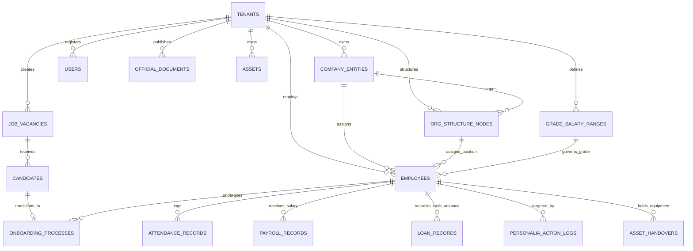
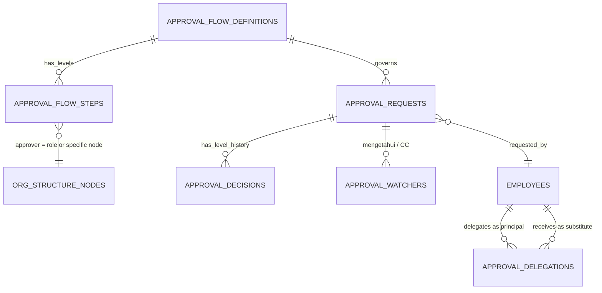
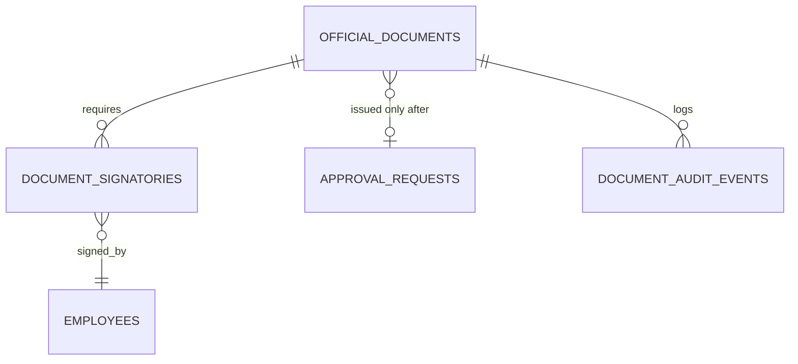
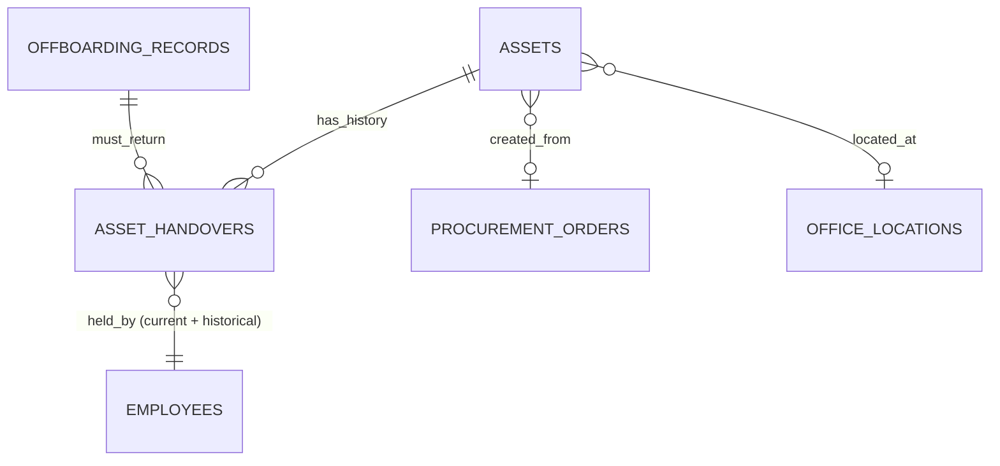
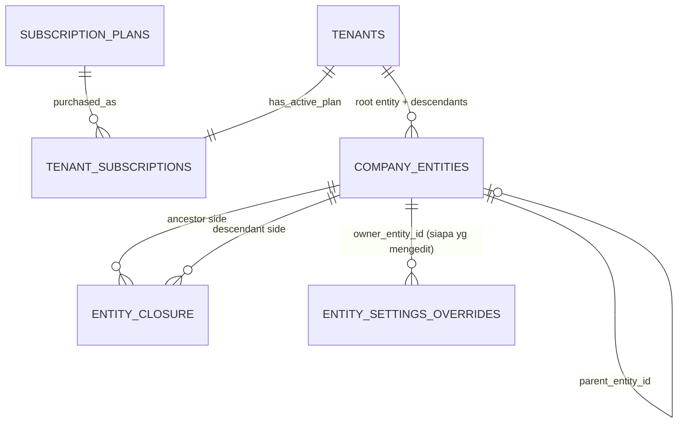

# Entity Relationship Diagram (ERD) & Data Dictionary
## NusaHR Enterprise HRMS

**Versi Dokumen:** 2.5.0 (Addendum Business-Flow Audit — §4 adalah model target revisi)
**Status:** §1-3 Baseline Lama (Belum Dibangun) · §4 Model Target Setelah Audit
**Database Dialect:** PostgreSQL 15+ / Supabase  

---

### 1. Diagram Relasi Entitas (Mermaid ERD)



---

### 2. Kamus Data & Skema Relasional (Data Dictionary)

#### 2.1. Tabel `tenants` (Penyewa SaaS / Perusahaan Induk)
| Kolom | Tipe Data | Constraint | Deskripsi |
|---|---|---|---|
| `id` | VARCHAR(64) | PK | Identifier unik tenant |
| `name` | VARCHAR(255) | NOT NULL | Nama resmi perusahaan |
| `code` | VARCHAR(50) | UNIQUE, NOT NULL | Singkatan / kode tenant (misal: NTM, MGL) |
| `logo_text` | VARCHAR(100) | | Teks representasi logo |
| `document_logo_url` | TEXT | | URL/Base64 Logo Dokumen Kop Resmi |
| `app_favicon_url` | TEXT | | URL/Base64 Icon Favicon Browser |
| `city` | VARCHAR(100) | NOT NULL | Kota domisili hukum |
| `umr` | NUMERIC(15,2) | NOT NULL | Standar upah minimum regional |
| `plan_tier` | VARCHAR(50) | NOT NULL | Starter, Professional, Enterprise |
| `created_at` | TIMESTAMPTZ | DEFAULT NOW() | Waktu pembuatan |

#### 2.2. Tabel `company_entities` (Hierarki Holding & Anak Perusahaan)
| Kolom | Tipe Data | Constraint | Deskripsi |
|---|---|---|---|
| `id` | VARCHAR(64) | PK | Identifier unik entitas |
| `tenant_id` | VARCHAR(64) | FK -> tenants.id | Relasi ke tenant pemilik |
| `parent_id` | VARCHAR(64) | FK -> company_entities.id | Parent holding jika anak/cucu |
| `name` | VARCHAR(255) | NOT NULL | Nama entitas bisnis |
| `code` | VARCHAR(50) | NOT NULL | Kode prefix entitas |
| `level` | VARCHAR(20) | NOT NULL | 'holding', 'anak', 'cucu' |
| `city` | VARCHAR(100) | NOT NULL | Kota operasional |
| `npwp` | VARCHAR(30) | NOT NULL | NPWP 16 digit entitas |

#### 2.3. Tabel `org_structure_nodes` (Master Posisi & Struktur Organisasi)
| Kolom | Tipe Data | Constraint | Deskripsi |
|---|---|---|---|
| `id` | VARCHAR(64) | PK | Identifier unik node jabatan |
| `tenant_id` | VARCHAR(64) | FK -> tenants.id | Relasi tenant |
| `entity_id` | VARCHAR(64) | FK -> company_entities.id | Relasi entitas bisnis |
| `title` | VARCHAR(150) | NOT NULL | Nama resmi posisi/jabatan (misal: "VP HC") |
| `department` | VARCHAR(100) | NOT NULL | Nama departemen/divisi |
| `reports_to_id` | VARCHAR(64) | FK -> org_structure_nodes.id | Atasan langsung |
| `current_employee_id`| VARCHAR(64) | Nullable | Pegawai yang menjabat saat ini |
| `is_vacant` | BOOLEAN | DEFAULT FALSE | Status lowong (vacant) |
| `level` | INT | NOT NULL | Eselon/tingkat kedalaman hierarki (1-7) |

#### 2.4. Tabel `employees` (Master Dossier Karyawan)
| Kolom | Tipe Data | Constraint | Deskripsi |
|---|---|---|---|
| `id` | VARCHAR(64) | PK | Identifier unik karyawan |
| `tenant_id` | VARCHAR(64) | FK -> tenants.id | Relasi tenant |
| `entity_id` | VARCHAR(64) | FK -> company_entities.id | Relasi entitas |
| `nik` | VARCHAR(50) | UNIQUE, NOT NULL | Nomor Induk Karyawan |
| `full_name` | VARCHAR(255) | NOT NULL | Nama lengkap dengan gelar |
| `avatar` | TEXT | | URL foto profil karyawan |
| `email` | VARCHAR(255) | NOT NULL | Email resmi kantor |
| `phone` | VARCHAR(50) | NOT NULL | Nomor kontak telepon / WA |
| `department` | VARCHAR(100) | NOT NULL | Departemen kerja |
| `position` | VARCHAR(150) | NOT NULL | Nama jabatan aktif |
| `grade` | VARCHAR(20) | NOT NULL | Golongan / Grade (L1 - E1) |
| `employment_type` | VARCHAR(50) | NOT NULL | 'Tetap', 'PKWT', 'Magang', 'Outsourcing' |
| `join_date` | DATE | NOT NULL | Tanggal mulai bekerja |
| `status` | VARCHAR(50) | NOT NULL | 'Aktif', 'Cuti Panjang', 'Resign', 'PHK' |
| `basic_salary` | NUMERIC(15,2) | NOT NULL | Gaji pokok (IDR) |
| `ptkp` | VARCHAR(20) | NOT NULL | Status PTKP (TK/0, K/1, dll) |
| `remaining_leave_days`| INT | DEFAULT 12 | Sisa hak cuti tahunan aktif |

#### 2.5. Tabel `job_vacancies` (Daftar Lowongan Kerja)
| Kolom | Tipe Data | Constraint | Deskripsi |
|---|---|---|---|
| `id` | VARCHAR(64) | PK | Identifier lowongan kerja |
| `tenant_id` | VARCHAR(64) | FK -> tenants.id | Relasi tenant |
| `title` | VARCHAR(200) | NOT NULL | Judul posisi lowongan |
| `department` | VARCHAR(100) | NOT NULL | Departemen yang membutuhkan |
| `employment_type` | VARCHAR(50) | NOT NULL | Tipe kontrak lowongan |
| `openings` | INT | DEFAULT 1 | Jumlah slot kebutuhan orang |
| `status` | VARCHAR(30) | NOT NULL | 'Aktif', 'Ditutup', 'Draft' |
| `salary_range` | VARCHAR(100) | | Estimasi budget kompensasi |
| `experience_required`| VARCHAR(100) | | Pengalaman yang disyaratkan |
| `target_join_date` | DATE | | Target tanggal mulai onboarding |
| `created_at` | TIMESTAMPTZ | DEFAULT NOW() | Tanggal pembukaan lowongan |

#### 2.6. Tabel `candidates` (Pelamar Rekrutmen)
| Kolom | Tipe Data | Constraint | Deskripsi |
|---|---|---|---|
| `id` | VARCHAR(64) | PK | Identifier pelamar |
| `job_vacancy_id` | VARCHAR(64) | FK -> job_vacancies.id | Relasi lowongan yang dilamar |
| `name` | VARCHAR(255) | NOT NULL | Nama pelamar |
| `email` | VARCHAR(255) | NOT NULL | Email pelamar |
| `phone` | VARCHAR(50) | NOT NULL | No telepon pelamar |
| `stage` | VARCHAR(50) | NOT NULL | 'Applied', 'Screening', 'Interview', 'Offering', 'Hired' |
| `expected_salary`| NUMERIC(15,2) | | Ekspektasi gaji pelamar |
| `interview_score`| INT | Nullable | Nilai evaluasi wawancara (0-100) |

#### 2.7. Tabel `onboarding_processes` (Alur Transisi Karyawan Baru)
| Kolom | Tipe Data | Constraint | Deskripsi |
|---|---|---|---|
| `id` | VARCHAR(64) | PK | Identifier proses onboarding |
| `tenant_id` | VARCHAR(64) | FK -> tenants.id | Relasi tenant |
| `source_type` | VARCHAR(50) | NOT NULL | 'recruitment' (Offering diterima) atau 'direct' |
| `candidate_id` | VARCHAR(64) | Nullable | Relasi pelamar jika via rekrutmen |
| `employee_id` | VARCHAR(64) | Nullable | Relasi ID karyawan |
| `employee_name` | VARCHAR(255) | NOT NULL | Nama calon karyawan |
| `position` | VARCHAR(150) | NOT NULL | Posisi yang akan diemban |
| `department` | VARCHAR(100) | NOT NULL | Departemen |
| `join_date` | DATE | NOT NULL | Tanggal masuk perdana |
| `status` | VARCHAR(50) | NOT NULL | 'In Progress', 'Completed' |
| `tasks` | JSONB | NOT NULL | Daftar checklist berkas, IT, dan induksi |

---

### 3. Strategi Indexing & Optimasi Query
```sql
CREATE INDEX idx_emp_tenant_status ON employees(tenant_id, status);
CREATE INDEX idx_emp_dept_pos ON employees(tenant_id, department, position);
CREATE INDEX idx_vac_tenant_status ON job_vacancies(tenant_id, status);
CREATE INDEX idx_cand_vac_stage ON candidates(job_vacancy_id, stage);
CREATE INDEX idx_onb_tenant_status ON onboarding_processes(tenant_id, status);
CREATE INDEX idx_org_tenant_vacant ON org_structure_nodes(tenant_id, is_vacant);
```

---

### 4. Model yang Diperbaiki (Hasil Audit Pre-Backend — lihat `docs/AUDIT_FINDINGS.md`)

> Bagian di atas (§1-3) adalah ERD lama yang hanya mencakup rekrutmen/onboarding/
> karyawan. Audit frontend menemukan bahwa model aslinya **tidak merepresentasikan**
> alur Approval, TTD/QR Dokumen, dan GA Asset secara memadai — field relasi berupa
> teks bebas, status lifecycle tidak lengkap, dan beberapa relasi hanya satu arah.
> Tabel-tabel berikut adalah desain target untuk backend nyata; frontend harus
> diselaraskan ke model ini sebelum/selama integrasi API.

#### 4.1. Approval Engine (menggantikan `ApprovalWorkflowItem` flat saat ini)



| Tabel | Kolom kunci | Catatan perbaikan |
|---|---|---|
| `approval_flow_definitions` | `id`, `tenant_id`, `category` (Cuti/SPPD/Pinjaman/Dokumen/...), `is_active` | **BARU** — layar Pengaturan admin mengedit baris ini, bukan hardcode di kode. |
| `approval_flow_steps` | `id`, `flow_definition_id`, `level_order`, `approver_type` ('role'\|'org_node'\|'specific_user'), `approver_ref`, `sla_hours` | **BARU** — SLA per level, approver bisa diikat ke node org chart spesifik, bukan hanya role string. |
| `approval_requests` | `id`, `tenant_id`, `entity_id`, `flow_definition_id`, `reference_type`, `reference_id`, `requester_id`, `current_level`, `status`, `due_at` | Pengganti `ApprovalWorkflowItem`; `entity_id` wajib diisi untuk isolasi multi-entity. |
| `approval_decisions` | `id`, `approval_request_id`, `level_order`, `decided_by`, `decision` ('Approve'\|'Reject'\|'Delegated'), `reason`, `decided_at` | **BARU** — riwayat per level tidak lagi hilang saat naik level. |
| `approval_watchers` | `id`, `approval_request_id`, `employee_id`, `role` ('mengetahui'), `acknowledged_at` | **BARU** — konsep CC/"mengetahui" terpisah dari approver pemutus. |
| `approval_delegations` | `id`, `principal_employee_id`, `substitute_employee_id`, `start_date`, `end_date`, `is_active` | Sudah ada di tipe frontend tapi **harus benar-benar dibaca** oleh resolver approver saat `principal` tidak hadir — lihat §3 System Design. |

Aturan wajib: `approval_requests.current_level` hanya boleh naik lewat baris baru di
`approval_decisions`; tidak ada jalur lain (modul manapun) yang boleh men-set status
`'Approved'` final tanpa melalui seluruh step di `approval_flow_steps`.

#### 4.2. Dokumen Resmi & Multi-Signer (menggantikan `signeeName`/`signeeRole` tunggal)



| Tabel | Kolom kunci | Catatan perbaikan |
|---|---|---|
| `official_documents` | `id`, `document_number` (NULLABLE sampai final), `status` ('Draft'\|'MenungguTtd'\|'RESMI_DITERBITKAN'\|'Dicabut'\|'Digantikan'), `qr_verification_url` (NULLABLE sampai semua signer confirm), `approval_request_id` | `document_number` & `qr_verification_url` **tidak boleh terisi** sebelum semua baris `document_signatories` berstatus `Confirmed`. |
| `document_signatories` | `id`, `document_id`, `employee_id`, `role` ('Pembuat'\|'Mengetahui'\|'Approver'), `sign_order`, `status` ('Pending'\|'Viewed'\|'Confirmed'\|'Rejected'), `confirmed_at`, `signature_hash` | **BARU** — menggantikan `signeeName`/`signeeRole` string tunggal; `signature_hash` adalah hash kriptografis nyata (bukan `Math.random()`). |
| `document_audit_events` | `id`, `document_id`, `actor_id`, `event` ('Created'\|'Viewed'\|'Confirmed'\|'Rejected'\|'QRGenerated'), `occurred_at` | **BARU** — jejak audit UU ITE yang bisa dibuktikan, terpisah dari `audit_log_entries` generik. |

#### 4.3. GA Asset Lifecycle (menggantikan status implisit `!assignedToEmployeeId`)



| Tabel | Kolom kunci | Catatan perbaikan |
|---|---|---|
| `assets` | `id`, `procurement_order_id` (NULLABLE), `purchase_date`, `warranty_expiry_date`, `office_location_id` (FK, bukan teks `building/room`), `status` ('Available'\|'Assigned'\|'InRepair'\|'Retired') | `status` adalah **satu sumber kebenaran** — wajib di-update oleh setiap aksi handover/return, tidak boleh dibiarkan optional seperti `usageStatus` saat ini. |
| `asset_handovers` | `id`, `asset_id`, `from_employee_id` (NULLABLE jika dari GA pool), `to_employee_id` (NULLABLE jika dikembalikan ke pool), `handover_date`, `return_date`, `condition_at_handover`, `condition_at_return`, `document_id` (FK ke BAST resmi) | Menggantikan `BastHandoverRecord` yang saat ini hidup di `localStorage` komponen — tabel ini wajib tenant-scoped dan jadi sumber kebenaran "siapa pegang apa sekarang" (query `to_employee_id` terbaru per asset). |
| `offboarding_records.required_asset_ids` | array/relasi ke `assets.id` | Menggantikan boolean tunggal `assetReturned` — melacak pengembalian per-aset, bukan per-karyawan. |

#### 4.4a. Hierarki Entitas Tak Terbatas, Visibilitas, & Paket Berlangganan — BARU

> Lihat `docs/PRD.md` §1.1 untuk penjelasan bisnisnya. `company_entities` versi lama
> (§2.2) hanya mengasumsikan 3 level (`level: 'holding'|'anak'|'cucu'`) — ini TIDAK
> cukup karena kedalaman pohon entitas tidak dibatasi.



| Tabel | Kolom kunci | Tujuan |
|---|---|---|
| `subscription_plans` | `id`, `name`, `allows_multi_entity` (bool), `max_employees`, `enabled_modules` (JSONB array nama modul), `duration_days`, `price` | Paket yang dijual Apps Owner. Minimal satu baris dengan `enabled_modules = ALL`. |
| `tenant_subscriptions` | `id`, `tenant_id`, `plan_id`, `started_at`, `expires_at`, `status` ('Aktif'\|'Expired'\|'Dibatalkan') | Histori & status langganan aktif tenant; dicek saat gating akses modul/jumlah karyawan. |
| `company_entities` | `id`, `tenant_id`, `parent_entity_id` (nullable — NULL = root), `name`, `code`, `email_domain` (TIDAK unique global — lihat poin 4 di PRD §1.1), `created_by_entity_id` | Diganti dari `level`/`parent_id` 3-tingkat tetap menjadi pohon rekursif tak terbatas kedalaman. |
| `entity_closure` | `ancestor_entity_id`, `descendant_entity_id`, `depth` | **Closure table** — baris pre-computed untuk setiap pasangan (leluhur, keturunan) di seluruh kedalaman. Dipakai agar query visibilitas ("semua entitas yang boleh dilihat entitas X") jadi `SELECT descendant_entity_id FROM entity_closure WHERE ancestor_entity_id = X` — O(1) index lookup, bukan recursive CTE tiap request. Baris di-maintain otomatis setiap `company_entities` baru dibuat (salin seluruh closure induknya + tambah dirinya sendiri). |
| `entity_settings_overrides` | `id`, `settings_domain` ('leave_policy'\|'asset_policy'\|dll), `data_entity_id` (milik siapa data ini), `owner_entity_id` (siapa yang berhak mengedit — bisa = `data_entity_id` sendiri, atau entitas leluhur yang mengambil alih) | Mengimplementasikan PRD §1.1 poin 6 (delegasi pengaturan). |

**Aturan query visibilitas (WAJIB, bukan opsional):**
```sql
-- Entitas X boleh melihat data entitas Y hanya jika:
SELECT 1 FROM entity_closure WHERE ancestor_entity_id = :X AND descendant_entity_id = :Y;
-- (termasuk X = Y, data milik sendiri). Sibling (anak-anak dari induk yang sama)
-- TIDAK akan muncul di hasil ini satu sama lain -- hanya leluhur mereka yang bisa.
```

**Pengecualian direktori ESS (PRD §1.1 poin 9):** query pencarian karyawan ESS
TIDAK memakai `entity_closure` — ia memakai `tenant_id` saja (seluruh tenant), tapi
hanya `SELECT photo_url, nik, full_name, position FROM employees WHERE tenant_id = :T`.
Ini satu-satunya query resmi yang sengaja melewati batas visibilitas hierarki di atas.

**Batas akses App Owner (PRD §1.1 poin 10 — koreksi):** App Owner TIDAK memiliki
akses baca ke `company_entities` maupun `entity_closure` sama sekali. Layar admin
App Owner (daftar/detail tenant) hanya boleh memanggil view agregat:
```sql
-- Satu-satunya yang App Owner boleh query terkait struktur tenant:
SELECT tenant_id, COUNT(DISTINCT id) AS entity_count
FROM company_entities GROUP BY tenant_id;
SELECT tenant_id, COUNT(*) AS user_count
FROM users GROUP BY tenant_id;
```
Tidak ada endpoint App Owner yang mengembalikan baris `company_entities` individual,
nama entitas, atau relasi `parent_entity_id`/`entity_closure` — ini harus ditegakkan
di level API (RBAC Super Admin/App Owner berbeda dari RBAC Tenant Admin), bukan
hanya disembunyikan di UI.

#### 4.3a. Harga Modular, Verifikasi Pembayaran & Pendaftaran Tenant — BARU (implementasi nyata, bukan lagi target)

> Ini sudah diimplementasikan di `server/db/schema.ts` dan berjalan di Supabase, berbeda dari §4.1-4.3 yang masih desain target.

| Tabel | Kolom kunci | Tujuan |
|---|---|---|
| `modules` | `id`, `code` (unik), `name`, `base_price_idr`, `price_per_user_idr`, `price_per_entity_idr`, `is_active` | Katalog harga per modul — App Owner atur sendiri lewat tab "Modul & Harga". |
| `subscription_plans` (+kolom baru) | `is_custom`, `max_entities`, `discount_percent` | Paket custom (satu baris khusus per tenant, dihitung otomatis dari `modules`) vs paket siap pakai (Starter/Enterprise). |
| `payment_verifications` | `id`, `tenant_id`, `amount_idr`, `bank_name`, `reference_number`, `note`, `status` (Pending/Approved/Rejected), `reviewed_by_user_id`, `rejection_reason` | Bukti transfer yang diisi saat signup, direview App Owner (approve = aktivasi tenant otomatis) — bukan klik "Aktifkan" tanpa bukti. |

Formula harga custom (`server/lib/pricing.ts`, pure function, unit-testable):
```
per_modul = base + (price_per_user * max_users) + (price_per_entity * max_entities)
subtotal  = sum(per_modul) * ceil(durasi_hari / 30)
final     = subtotal - (subtotal * discount_percent / 100)
```

App Owner bisa membuat tenant langsung (`POST /api/app-owner/tenants`, mode `preset` atau `custom`) — aktif seketika tanpa antrian verifikasi pembayaran, karena App Owner sendiri yang membuatnya.

#### 4.4. Normalisasi Relasi Organisasi

- `employees.department_id` → FK `company_departments.id` (ganti `department` teks bebas).
- `employees.org_node_id` → FK `org_structure_nodes.id` — setiap aksi Personalia
  (promosi/demosi/mutasi) WAJIB meng-update `org_structure_nodes.current_employee_id`
  pada node lama (jadi vacant) dan node baru dalam satu transaksi.
- Hapus salah satu dari `employees.manager_id` vs `employees.direct_supervisor` —
  jadikan `manager_id` (FK) satu-satunya sumber kebenaran garis pelaporan.
- `employee_loans.loan_scheme_id` → FK `loan_scheme_configs.id` (wajib diisi).
- `leave_ledger_entries` (BARU): `id`, `employee_id`, `bucket` ('CutiBersama'\|'CutiTahunan'),
  `delta_days`, `source_reference_id`, `effective_date` — menggantikan pengurangan
  langsung ke `employees.remaining_leave_days` tanpa jejak, dan menggantikan hitungan
  "cuti bersama" yang hanya dihitung ulang di render.
