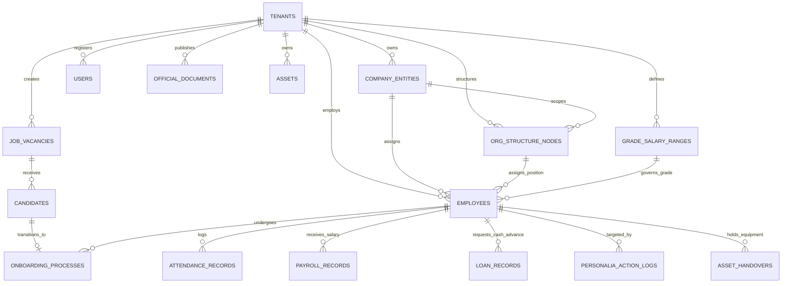

# Entity Relationship Diagram (ERD) & Data Dictionary
## NusaHR Enterprise HRMS

**Versi Dokumen:** 2.4.0  
**Status:** Approved  
**Database Dialect:** PostgreSQL 15+ / Supabase  

---

### 1. Diagram Relasi Entitas (Mermaid ERD)



---

### 2. Kamus Data & Skema Relasional (Data Dictionary)

#### 2.1. Tabel `tenants` (Penyewa SaaS / Perusahaan Induk)
| Kolom | Tipe Data | Constraint | Deskripsi |
|---|---|---|---|
| `id` | VARCHAR(64) | PK | Identifier unik tenant |
| `name` | VARCHAR(255) | NOT NULL | Nama resmi perusahaan |
| `code` | VARCHAR(50) | UNIQUE, NOT NULL | Singkatan / kode tenant (misal: NTM, MGL) |
| `logo_text` | VARCHAR(100) | | Teks representasi logo |
| `document_logo_url` | TEXT | | URL/Base64 Logo Dokumen Kop Resmi |
| `app_favicon_url` | TEXT | | URL/Base64 Icon Favicon Browser |
| `city` | VARCHAR(100) | NOT NULL | Kota domisili hukum |
| `umr` | NUMERIC(15,2) | NOT NULL | Standar upah minimum regional |
| `plan_tier` | VARCHAR(50) | NOT NULL | Starter, Professional, Enterprise |
| `created_at` | TIMESTAMPTZ | DEFAULT NOW() | Waktu pembuatan |

#### 2.2. Tabel `company_entities` (Hierarki Holding & Anak Perusahaan)
| Kolom | Tipe Data | Constraint | Deskripsi |
|---|---|---|---|
| `id` | VARCHAR(64) | PK | Identifier unik entitas |
| `tenant_id` | VARCHAR(64) | FK -> tenants.id | Relasi ke tenant pemilik |
| `parent_id` | VARCHAR(64) | FK -> company_entities.id | Parent holding jika anak/cucu |
| `name` | VARCHAR(255) | NOT NULL | Nama entitas bisnis |
| `code` | VARCHAR(50) | NOT NULL | Kode prefix entitas |
| `level` | VARCHAR(20) | NOT NULL | 'holding', 'anak', 'cucu' |
| `city` | VARCHAR(100) | NOT NULL | Kota operasional |
| `npwp` | VARCHAR(30) | NOT NULL | NPWP 16 digit entitas |

#### 2.3. Tabel `org_structure_nodes` (Master Posisi & Struktur Organisasi)
| Kolom | Tipe Data | Constraint | Deskripsi |
|---|---|---|---|
| `id` | VARCHAR(64) | PK | Identifier unik node jabatan |
| `tenant_id` | VARCHAR(64) | FK -> tenants.id | Relasi tenant |
| `entity_id` | VARCHAR(64) | FK -> company_entities.id | Relasi entitas bisnis |
| `title` | VARCHAR(150) | NOT NULL | Nama resmi posisi/jabatan (misal: "VP HC") |
| `department` | VARCHAR(100) | NOT NULL | Nama departemen/divisi |
| `reports_to_id` | VARCHAR(64) | FK -> org_structure_nodes.id | Atasan langsung |
| `current_employee_id`| VARCHAR(64) | Nullable | Pegawai yang menjabat saat ini |
| `is_vacant` | BOOLEAN | DEFAULT FALSE | Status lowong (vacant) |
| `level` | INT | NOT NULL | Eselon/tingkat kedalaman hierarki (1-7) |

#### 2.4. Tabel `employees` (Master Dossier Karyawan)
| Kolom | Tipe Data | Constraint | Deskripsi |
|---|---|---|---|
| `id` | VARCHAR(64) | PK | Identifier unik karyawan |
| `tenant_id` | VARCHAR(64) | FK -> tenants.id | Relasi tenant |
| `entity_id` | VARCHAR(64) | FK -> company_entities.id | Relasi entitas |
| `nik` | VARCHAR(50) | UNIQUE, NOT NULL | Nomor Induk Karyawan |
| `full_name` | VARCHAR(255) | NOT NULL | Nama lengkap dengan gelar |
| `avatar` | TEXT | | URL foto profil karyawan |
| `email` | VARCHAR(255) | NOT NULL | Email resmi kantor |
| `phone` | VARCHAR(50) | NOT NULL | Nomor kontak telepon / WA |
| `department` | VARCHAR(100) | NOT NULL | Departemen kerja |
| `position` | VARCHAR(150) | NOT NULL | Nama jabatan aktif |
| `grade` | VARCHAR(20) | NOT NULL | Golongan / Grade (L1 - E1) |
| `employment_type` | VARCHAR(50) | NOT NULL | 'Tetap', 'PKWT', 'Magang', 'Outsourcing' |
| `join_date` | DATE | NOT NULL | Tanggal mulai bekerja |
| `status` | VARCHAR(50) | NOT NULL | 'Aktif', 'Cuti Panjang', 'Resign', 'PHK' |
| `basic_salary` | NUMERIC(15,2) | NOT NULL | Gaji pokok (IDR) |
| `ptkp` | VARCHAR(20) | NOT NULL | Status PTKP (TK/0, K/1, dll) |
| `remaining_leave_days`| INT | DEFAULT 12 | Sisa hak cuti tahunan aktif |

#### 2.5. Tabel `job_vacancies` (Daftar Lowongan Kerja)
| Kolom | Tipe Data | Constraint | Deskripsi |
|---|---|---|---|
| `id` | VARCHAR(64) | PK | Identifier lowongan kerja |
| `tenant_id` | VARCHAR(64) | FK -> tenants.id | Relasi tenant |
| `title` | VARCHAR(200) | NOT NULL | Judul posisi lowongan |
| `department` | VARCHAR(100) | NOT NULL | Departemen yang membutuhkan |
| `employment_type` | VARCHAR(50) | NOT NULL | Tipe kontrak lowongan |
| `openings` | INT | DEFAULT 1 | Jumlah slot kebutuhan orang |
| `status` | VARCHAR(30) | NOT NULL | 'Aktif', 'Ditutup', 'Draft' |
| `salary_range` | VARCHAR(100) | | Estimasi budget kompensasi |
| `experience_required`| VARCHAR(100) | | Pengalaman yang disyaratkan |
| `target_join_date` | DATE | | Target tanggal mulai onboarding |
| `created_at` | TIMESTAMPTZ | DEFAULT NOW() | Tanggal pembukaan lowongan |

#### 2.6. Tabel `candidates` (Pelamar Rekrutmen)
| Kolom | Tipe Data | Constraint | Deskripsi |
|---|---|---|---|
| `id` | VARCHAR(64) | PK | Identifier pelamar |
| `job_vacancy_id` | VARCHAR(64) | FK -> job_vacancies.id | Relasi lowongan yang dilamar |
| `name` | VARCHAR(255) | NOT NULL | Nama pelamar |
| `email` | VARCHAR(255) | NOT NULL | Email pelamar |
| `phone` | VARCHAR(50) | NOT NULL | No telepon pelamar |
| `stage` | VARCHAR(50) | NOT NULL | 'Applied', 'Screening', 'Interview', 'Offering', 'Hired' |
| `expected_salary`| NUMERIC(15,2) | | Ekspektasi gaji pelamar |
| `interview_score`| INT | Nullable | Nilai evaluasi wawancara (0-100) |

#### 2.7. Tabel `onboarding_processes` (Alur Transisi Karyawan Baru)
| Kolom | Tipe Data | Constraint | Deskripsi |
|---|---|---|---|
| `id` | VARCHAR(64) | PK | Identifier proses onboarding |
| `tenant_id` | VARCHAR(64) | FK -> tenants.id | Relasi tenant |
| `source_type` | VARCHAR(50) | NOT NULL | 'recruitment' (Offering diterima) atau 'direct' |
| `candidate_id` | VARCHAR(64) | Nullable | Relasi pelamar jika via rekrutmen |
| `employee_id` | VARCHAR(64) | Nullable | Relasi ID karyawan |
| `employee_name` | VARCHAR(255) | NOT NULL | Nama calon karyawan |
| `position` | VARCHAR(150) | NOT NULL | Posisi yang akan diemban |
| `department` | VARCHAR(100) | NOT NULL | Departemen |
| `join_date` | DATE | NOT NULL | Tanggal masuk perdana |
| `status` | VARCHAR(50) | NOT NULL | 'In Progress', 'Completed' |
| `tasks` | JSONB | NOT NULL | Daftar checklist berkas, IT, dan induksi |

---

### 3. Strategi Indexing & Optimasi Query
```sql
CREATE INDEX idx_emp_tenant_status ON employees(tenant_id, status);
CREATE INDEX idx_emp_dept_pos ON employees(tenant_id, department, position);
CREATE INDEX idx_vac_tenant_status ON job_vacancies(tenant_id, status);
CREATE INDEX idx_cand_vac_stage ON candidates(job_vacancy_id, stage);
CREATE INDEX idx_onb_tenant_status ON onboarding_processes(tenant_id, status);
CREATE INDEX idx_org_tenant_vacant ON org_structure_nodes(tenant_id, is_vacant);
```
