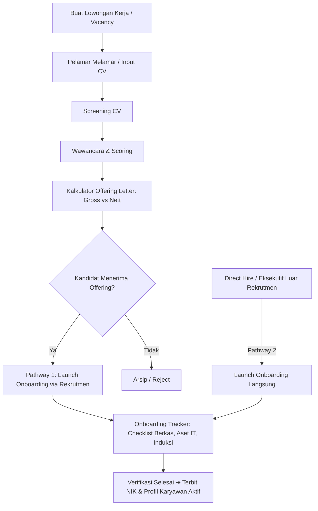
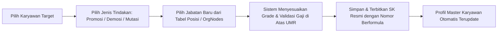
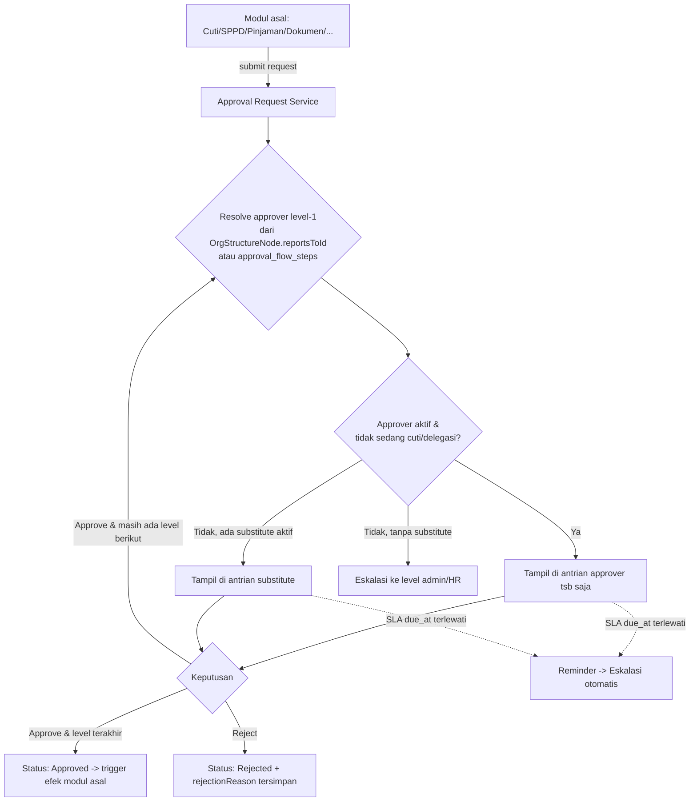
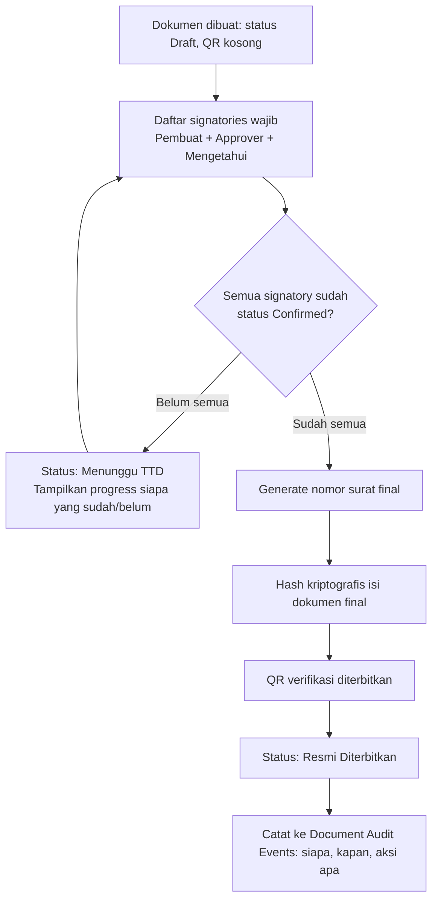

# System Architecture & High-Level Design (HLD)
## NusaHR Enterprise HRMS

**Versi Dokumen:** 2.5.0 (Addendum Business-Flow Audit — §3.3-3.5)
**Status:** Approved (arsitektur presentasi) — Approval/Document Engine Perlu Dibangun Ulang
**Tanggal:** 24 Oktober 2026 (revisi 31 Oktober 2026)

---

### 1. Arsitektur Tingkat Tinggi (High-Level Architecture)

NusaHR dirancang dengan pendekatan modular berbasis React 19 + TypeScript dengan arsitektur Multi-Tenant Shared Database / Shared Schema with Tenant Discriminator (`tenantId`), siap disambungkan ke PostgreSQL / Supabase backend via REST/GraphQL API.

```
+-----------------------------------------------------------------------------------+
|                              PRESENTATION LAYER                                   |
|  +-----------------------------------------------------------------------------+  |
|  | Modern Responsive Layout (Desktop / Tablet / Mobile Viewports)              |  |
|  | +-----------------+ +-----------------------------------------------------+ |  |
|  | | Collapsible     | | Top Header: Tenant Switcher, Entity Tree, Global     | |  |
|  | | Sidebar Nav     | | Search Bar, RBAC Switcher, User Session Info         | |  |
|  | +-----------------+ +-----------------------------------------------------+ |  |
|  |                     | Dedicated Sub-Menu Tabs (Horizontal Scrollable)      | |  |
|  |                     +-----------------------------------------------------+ |  |
|  |                     | Module Workspaces: Recruitment, Employees, Payroll, | |  |
|  |                     | Attendance, Documents, Assets, Compliance, etc.      | |  |
|  +---------------------+-----------------------------------------------------+--+  |
+-----------------------------------------------------------------------------------+
                                         |
                                         v
+-----------------------------------------------------------------------------------+
|                             APPLICATION & STATE LAYER                             |
|  +-----------------------------------------------------------------------------+  |
|  | HrmsContext (Unified Global State & Event Dispatcher)                       |  |
|  | - Multi-tenant Isolation Enforcement (tenantId & entityId filters)          |  |
|  | - Reactive Actions: CRUD Karyawan, Onboarding Pipeline, Lowongan Kerja     |  |
|  | - Branding Engine: Live Document Logo & App Favicon injection to DOM      |  |
|  | - Modal Dismiss & Outside-Click Event Handlers                             |  |
|  +-----------------------------------------------------------------------------+  |
|  +-----------------------------------------------------------------------------+  |
|  | Business Calculation Engines (Pure Typescript Utilities)                    |  |
|  | - PPh 21 TER 2024 Engine (PMK 168/2023 TER A, B, C & Pasal 17)             |  |
|  | - BPJS Ketenagakerjaan & Kesehatan Actuarial Calculator                    |  |
|  | - DOCX Template Variable Parser & Roman/Formula Numbering Evaluator         |  |
|  | - PDF Generator & SHA-256 Digital Signature Generator (UU ITE No. 11/2008)  |  |
|  +-----------------------------------------------------------------------------+  |
+-----------------------------------------------------------------------------------+
                                         |
                                         v
+-----------------------------------------------------------------------------------+
|                              PERSISTENCE & DATA LAYER                             |
|  +--------------------+  +-----------------------+  +--------------------------+  |
|  | PostgreSQL Database|  | Supabase Storage / S3 |  | Client Cache / LocalSync |  |
|  | Multi-tenant Schema|  | Dokumen SK, Foto      |  | Offline Fast Resiliency  |  |
|  | Relational Tables  |  | Avatar, Logo Dokumen  |  | IndexedDB / Session      |  |
|  +--------------------+  +-----------------------+  +--------------------------+  |
+-----------------------------------------------------------------------------------+
```

---

### 2. Multi-Tenancy & Isolasi Data

> **Revisi 31 Oktober 2026:** model di bawah ini (filter `tenantId` datar) adalah
> baseline lama dan TIDAK CUKUP untuk model bisnis yang sebenarnya (lihat
> `docs/PRD.md` §1.1 dan `docs/ERD.md` §4.4a). Isolasi yang benar butuh dua lapis:
> tenant-level (seperti sekarang) DAN entity-hierarchy-level (baru, lihat §2.1).

Setiap transaksi dan entitas data memiliki atribut:
- `tenantId` (UUID perusahaan pelanggan SaaS)
- `entityId` (UUID entitas spesifik dalam pohon entitas tenant tersebut — kedalaman
  tak terbatas, bukan cuma Holding/Anak/Cucu)

Lapis pertama (wajib untuk semua tabel, tidak ada pengecualian):
```typescript
const currentTenantEmployees = employees.filter(emp => emp.tenantId === currentTenant.id);
```
Hal ini menjamin tidak terjadi *cross-tenant data leakage*. **Catatan audit:**
implementasi saat ini sudah menerapkan ini untuk hampir semua koleksi KECUALI
`businessTrips`, yang punya *fallback bug* menampilkan data semua tenant saat tenant
aktif belum punya data — lihat `docs/AUDIT_FINDINGS.md` §4, harus diperbaiki sebelum
backend dibangun, bukan dibawa sebagai pola yang "boleh".

#### 2.1. Lapis Kedua — Visibilitas Hierarki Entitas (BARU)

Berbeda dari isolasi tenant (biner: milik tenant ini atau bukan), visibilitas antar
entitas bersifat **hierarkis dan asimetris**:
- Entitas induk melihat SEMUA keturunannya (anak, cucu, cicit, dst — tak terbatas
  level).
- Entitas anak hanya melihat keturunannya sendiri, TIDAK melihat entitas
  setara/sibling (anak lain dari induk yang sama).

Implementasi: tabel `entity_closure` (closure table, lihat `docs/ERD.md` §4.4a)
di-maintain setiap kali entitas baru dibuat, sehingga query visibilitas selalu
berupa index lookup `O(1)`, bukan recursive CTE yang dihitung ulang tiap request:
```sql
SELECT descendant_entity_id FROM entity_closure WHERE ancestor_entity_id = :currentEntity;
```
Setiap endpoint API yang mengembalikan data ber-`entityId` (employees, assets,
documents, payroll, dll) WAJIB menambahkan filter ini di atas filter `tenantId` —
ini adalah gap nyata di implementasi sekarang (`docs/AUDIT_FINDINGS.md` §4: hanya
4 dari ~35 koleksi yang menerapkan filter `entityId` sama sekali, dan yang
diterapkan pun masih filter datar, belum hierarkis).

**Pengecualian terdokumentasi:** direktori pencarian karyawan di ESS sengaja
melewati §2.1 dan hanya memakai filter tenant (lihat `docs/ERD.md` §4.4a) — field
yang dikembalikan dibatasi ketat (foto, NIK, jabatan saja) untuk menjaga privasi
meski visibilitasnya tenant-wide.

**Koreksi penting (31 Okt 2026):** hierarki entitas §2.1 adalah **urusan tenant**,
ditegakkan untuk pengguna DI DALAM tenant tersebut (admin entitas, holding, dst) —
bukan untuk App Owner. App Owner berjalan di lapisan RBAC yang sama sekali berbeda
(lihat §2.4) dan tidak pernah memanggil query `entity_closure`.

#### 2.2. Delegasi Pengaturan Antar Entitas

Setiap domain pengaturan (kebijakan cuti, kebijakan aset, dll) disimpan dengan dua
atribut: `data_entity_id` (milik siapa) dan `owner_entity_id` (siapa yang boleh
mengedit — defaultnya sama dengan `data_entity_id`, tapi entitas leluhur bisa
mengambil alih). Saat memuat form pengaturan, UI harus resolve
`effective_owner_entity_id` lebih dulu sebelum menampilkan form sebagai
editable/read-only.

#### 2.3. Gating Paket Berlangganan

Setiap request yang (a) menambah karyawan baru, (b) mengaktifkan mode multi-entitas,
atau (c) mengakses modul tertentu, WAJIB dicek dulu terhadap
`tenant_subscriptions` + `subscription_plans` milik tenant yang aktif
(`max_employees`, `allows_multi_entity`, `enabled_modules`, `expires_at`). Ini
adalah gate di level API/service, bukan sekadar sembunyikan menu di UI.

#### 2.4. Lapisan App Owner — Hanya Agregat, Bukan Struktur (BARU)

App Owner (SaaS Owner) mengakses tenant melalui RBAC terpisah dari RBAC internal
tenant. Semua layar App Owner (daftar tenant, detail tenant untuk billing) hanya
boleh memanggil endpoint agregat (`COUNT` entitas, `COUNT` user per tenant — lihat
`docs/ERD.md` §4.4a) dan TIDAK PERNAH mengembalikan baris `company_entities`
individual atau `entity_closure`. Ini ditegakkan di level service/API (role
App Owner tidak memiliki scope baca ke tabel tersebut sama sekali), bukan sekadar
disembunyikan di UI — pola yang sama dengan kegagalan RBAC yang ditemukan di
`docs/AUDIT_FINDINGS.md` §1 (RBAC matrix saat ini dekoratif) harus dihindari di sini.

---

### 3. Alur Kerja Modul Utama (Key Business Workflows)

#### 3.1. Alur Rekrutmen hingga Onboarding (Dual Pathways)


#### 3.2. Alur Tindakan Personalia (Promosi & Demosi)


---

### 3.3. Status Implementasi Aktual (Pre-Backend) — Koreksi per Audit 31 Okt 2026

> Lihat `docs/AUDIT_FINDINGS.md` untuk detail lengkap. Diagram §3.1-3.2 di atas
> menggambarkan alur IDEAL; implementasi frontend saat ini punya penyimpangan
> berikut yang wajib diperbaiki sebelum/selama pembangunan backend:

- **Persistensi bukan murni in-memory.** Hampir seluruh state di `HrmsContext`
  disinkronkan ke `localStorage` per-browser dengan logika "merge manual dengan seed
  data" yang berbeda tiap entitas — bukan database sungguhan, dan rawan duplikat
  data saat skema berubah. Beberapa modul (BAST aset GA, skema pinjaman) bahkan
  menyimpan state pentingnya di `localStorage` key sendiri di luar `HrmsContext`,
  sehingga tidak ter-scope tenant dan tidak terlihat modul lain.
- **Approval belum jadi "engine" generik.** Level & approver per kategori hardcode
  di kode (bukan data konfigurasi), antrian approval tidak ter-scope ke approver yang
  login, dan beberapa modul memiliki jalur pintas yang melompati level approval yang
  seharusnya berjenjang.
- **Isolasi multi-entity tidak lengkap.** Filter `tenantId` konsisten diterapkan,
  tapi filter `entityId` (untuk struktur holding/anak perusahaan) hanya diterapkan
  pada 4 dari ~35 koleksi data.

### 3.4. Approval Engine — Arsitektur Target



### 3.5. Alur Tanda Tangan Dokumen & QR — Arsitektur Target



---

### 4. Strategi Desain Responsif (Tablet & Mobile Overhaul)
1. **Header Top Bar:**
   - Lebar komponen dibuat dinamis dengan prioritas breakpoint:
     - `sm (640px)`: Sembunyikan label panjang, tampilkan icon dengan tooltip.
     - `md (768px - Tablet)`: Kontrol dropdown tenant/peran diformat ringkas.
     - `lg (1024px)`: Tampilkan breadcrumb lengkap.
2. **Sub-Menu Tabs:**
   - Dipisahkan dari baris judul halaman.
   - Ditempatkan pada bar khusus dengan `overflow-x-auto whitespace-nowrap` yang ramah sentuhan (touch scroll) di iPad/tablet dan mobile.
3. **Modal Dialog:**
   - Semua modal memiliki listener klik backdrop (`onClick={(e) => { if (e.target === e.currentTarget) onClose(); }}`) serta penekanan tombol `Escape` untuk menutup modal seketika.
