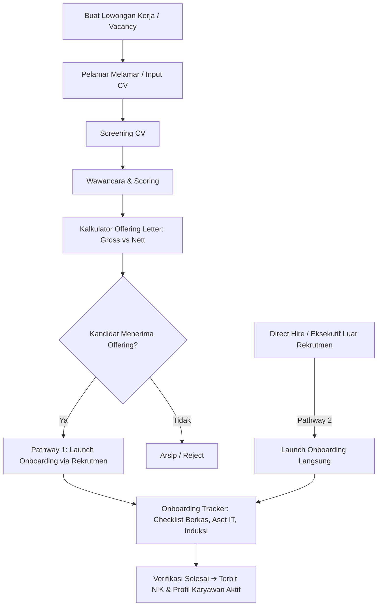
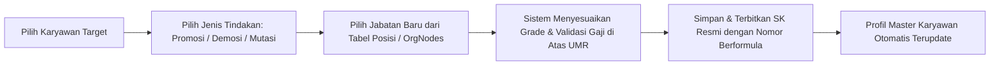

# System Architecture & High-Level Design (HLD)
## NusaHR Enterprise HRMS

**Versi Dokumen:** 2.4.0  
**Status:** Approved  
**Tanggal:** 24 Oktober 2026  

---

### 1. Arsitektur Tingkat Tinggi (High-Level Architecture)

NusaHR dirancang dengan pendekatan modular berbasis React 19 + TypeScript dengan arsitektur Multi-Tenant Shared Database / Shared Schema with Tenant Discriminator (`tenantId`), siap disambungkan ke PostgreSQL / Supabase backend via REST/GraphQL API.

```
+-----------------------------------------------------------------------------------+
|                              PRESENTATION LAYER                                   |
|  +-----------------------------------------------------------------------------+  |
|  | Modern Responsive Layout (Desktop / Tablet / Mobile Viewports)              |  |
|  | +-----------------+ +-----------------------------------------------------+ |  |
|  | | Collapsible     | | Top Header: Tenant Switcher, Entity Tree, Global     | |  |
|  | | Sidebar Nav     | | Search Bar, RBAC Switcher, User Session Info         | |  |
|  | +-----------------+ +-----------------------------------------------------+ |  |
|  |                     | Dedicated Sub-Menu Tabs (Horizontal Scrollable)      | |  |
|  |                     +-----------------------------------------------------+ |  |
|  |                     | Module Workspaces: Recruitment, Employees, Payroll, | |  |
|  |                     | Attendance, Documents, Assets, Compliance, etc.      | |  |
|  +---------------------+-----------------------------------------------------+--+  |
+-----------------------------------------------------------------------------------+
                                         |
                                         v
+-----------------------------------------------------------------------------------+
|                             APPLICATION & STATE LAYER                             |
|  +-----------------------------------------------------------------------------+  |
|  | HrmsContext (Unified Global State & Event Dispatcher)                       |  |
|  | - Multi-tenant Isolation Enforcement (tenantId & entityId filters)          |  |
|  | - Reactive Actions: CRUD Karyawan, Onboarding Pipeline, Lowongan Kerja     |  |
|  | - Branding Engine: Live Document Logo & App Favicon injection to DOM      |  |
|  | - Modal Dismiss & Outside-Click Event Handlers                             |  |
|  +-----------------------------------------------------------------------------+  |
|  +-----------------------------------------------------------------------------+  |
|  | Business Calculation Engines (Pure Typescript Utilities)                    |  |
|  | - PPh 21 TER 2024 Engine (PMK 168/2023 TER A, B, C & Pasal 17)             |  |
|  | - BPJS Ketenagakerjaan & Kesehatan Actuarial Calculator                    |  |
|  | - DOCX Template Variable Parser & Roman/Formula Numbering Evaluator         |  |
|  | - PDF Generator & SHA-256 Digital Signature Generator (UU ITE No. 11/2008)  |  |
|  +-----------------------------------------------------------------------------+  |
+-----------------------------------------------------------------------------------+
                                         |
                                         v
+-----------------------------------------------------------------------------------+
|                              PERSISTENCE & DATA LAYER                             |
|  +--------------------+  +-----------------------+  +--------------------------+  |
|  | PostgreSQL Database|  | Supabase Storage / S3 |  | Client Cache / LocalSync |  |
|  | Multi-tenant Schema|  | Dokumen SK, Foto      |  | Offline Fast Resiliency  |  |
|  | Relational Tables  |  | Avatar, Logo Dokumen  |  | IndexedDB / Session      |  |
|  +--------------------+  +-----------------------+  +--------------------------+  |
+-----------------------------------------------------------------------------------+
```

---

### 2. Multi-Tenancy & Isolasi Data
Setiap transaksi dan entitas data memiliki atribut:
- `tenantId` (UUID perusahaan pelanggan SaaS)
- `entityId` (UUID hierarki entitas: Holding, Anak, atau Cucu Perusahaan)

Semua query pada `HrmsContext` difilter secara ketat:
```typescript
const currentTenantEmployees = employees.filter(emp => emp.tenantId === currentTenant.id);
```
Hal ini menjamin tidak terjadi *cross-tenant data leakage*.

---

### 3. Alur Kerja Modul Utama (Key Business Workflows)

#### 3.1. Alur Rekrutmen hingga Onboarding (Dual Pathways)


#### 3.2. Alur Tindakan Personalia (Promosi & Demosi)


---

### 4. Strategi Desain Responsif (Tablet & Mobile Overhaul)
1. **Header Top Bar:**
   - Lebar komponen dibuat dinamis dengan prioritas breakpoint:
     - `sm (640px)`: Sembunyikan label panjang, tampilkan icon dengan tooltip.
     - `md (768px - Tablet)`: Kontrol dropdown tenant/peran diformat ringkas.
     - `lg (1024px)`: Tampilkan breadcrumb lengkap.
2. **Sub-Menu Tabs:**
   - Dipisahkan dari baris judul halaman.
   - Ditempatkan pada bar khusus dengan `overflow-x-auto whitespace-nowrap` yang ramah sentuhan (touch scroll) di iPad/tablet dan mobile.
3. **Modal Dialog:**
   - Semua modal memiliki listener klik backdrop (`onClick={(e) => { if (e.target === e.currentTarget) onClose(); }}`) serta penekanan tombol `Escape` untuk menutup modal seketika.
